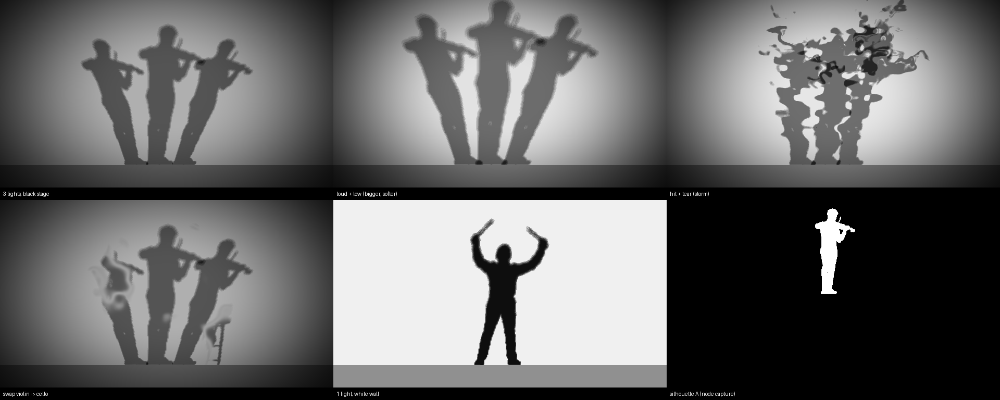

# 影（empreintes_tex への追加）

`empreintes_tex.maxpat` の映像の素に「動画」と並べて「演奏者の影」を加える。
演奏者の3Dモデルを回しながら壁に影を落とし、その映像を、動画と同じエフェクトの列（溶ける・ガラス・輪郭の粒子・時間…）と生成の核（流体・反応拡散・繊維）に流す。



この画像は、`sh_cast` と同じ計算を Python に移して描いたプレビュー。Max の出力ではない。

## 仕組み

```
jit.gl.model（A） → jit.gl.node ept_shA（白い形、アルファが形） → ept_shAcap ┐
jit.gl.model（B） → jit.gl.node ept_shB                          → ept_shBcap ┼→ sh_cast（壁・光3つ・半影・ちぎれ・入れ替わり・残像）
                                                       1コマ前の sh_cast ────────┘        ↓
                                                                    fx_distort の左の入口（動画と同じ場所）→ 以降は今の列のまま
```

- 映像の素は `gate 2 1` で切り替える。プリセットの `"src": "shadow"` で影になり、そのとき動画は手放す（dispose）。
- 毎コマの流れは、粒子の群れ（`ept_pncap`）と同じ作りにした。node の写しを名前つきのテクスチャに置き、次のコマの頭に読む。

## 音との対応

| 音 | 影の動き |
| --- | --- |
| 音量 | 回る速さ（毎コマ 0.2〜2度）、壁の明るさ、半影の広さ |
| 低域 | 光が近づいて影が大きく脈打つ |
| 一撃 | 光が揺れて影がぶれる、壁が瞬く。「一撃で次の人」がオンなら別の演奏者に入れ替わる（5秒に1回まで） |
| 嵐 | `shtear` があると、影が上の方からちぎれる |

演奏者を入れ替えるときは、今見えていない側（A/B）に読み込んでから、`shswap` を2.5秒かけて 0→1 にする。
壁の上に fBm の境目が走り、その境目が光りながら次の人の影に置き換わる。

## 入れ方

1. **差分を当てる**：`build_tex.py` があるフォルダで `git apply build_tex_shadow.diff`、または `patch -p1 < build_tex_shadow.diff`
2. **シェーダーを置く**：`sh_cast.genexpr` を `shaders/` にコピーする
3. **プリセットを足す**：`presets_shadow.json` の5つを、`presets.json` の `"presets"` の末尾に足す
   - 影 ／ 影が溶ける ／ 影が散る ／ 影が入れ替わる ／ 影と墨
4. **演奏者のメッシュを置く**：28人分の `models/shadow/<id>.obj` は Git LFS で入っている（足が y=0、高さ 1、8万面、1人約7MB）
   - 初めての Mac では `brew install git-lfs && git lfs install` をしてから、transinst で `git lfs pull` する
   - 作り直すときは `python3 scripts/export_shadow_meshes.py`（Meshy の GLB が必要）
   - `models/shadow` を `performers/` としてパッチの横にコピーし、Max の検索パスに入れる（Options → File Preferences）
5. `python build_tex.py`

## 操作

- **プリセットのボタンの下**：演奏者を選ぶメニューと「一撃で次の人」のトグル
- **OSC 7491**：
  - `/performer <id>`：演奏者を入れ替える（例：`python osc.py /performer cello`）
  - `/src 0|1`：映像の素。0 = 動画、1 = 影
- **プリセットの書き方**：
  - `"src": "shadow"`：影を映像の素にする（`"video": 1` も必要）
  - `"shauto": 1`：一撃で次の人
  - `"shadow": {...}`：下の量を上書き

| param | 既定 | 意味 |
| --- | --- | --- |
| `shlights` | 3 | 光の数（1〜3）。重なった所ほど暗い |
| `shspread` | 0.5 | 光どうしの離れ具合（影の開き） |
| `shsize` | 1.5 | 影の大きさ |
| `shsoft` | 0.5 | 半影（足もとはくっきり、上ほどぼける） |
| `shtear` | 0 | ちぎれる量（嵐と一撃で効く） |
| `shtrail` | 0 | 残像（影が少しずつ消える） |
| `shspin` | 1 | 回る速さの倍率 |
| `shfloor` | 0.12 | 壁の床の線の高さ（画面の下から） |
| `shsrcfoot` | 0.5 | 写しの中の足の高さ（モデルの足を画面の中央に置いている） |

`light`（白地）がオンのときは、壁全体が明るくなる。オフのときは、床の上のスポットライトだけが当たる。

## 確かめたこと・まだのこと

**確かめたこと**
- `empreintes_tex.maxpat` から次のものを復元した。
  - Patch クラス（`ab-particles/max/build_patch.py` の代わり）
  - `shaders/*.genexpr`
  - `presets.json`
- 元の `build_tex.py` をそのまま流すと、渡されたパッチと同じ内容（JSON）が出ることを確認した。
- その上でこの差分を当てて、パッチが組めることを確認した（468 → 535 ボックス）。
- 配線を機械的に検査した。存在しないボックスや出口・入口へのつなぎはない。`t`・`route`・`gate`・`sel` の出口の数も、テキストと合っている。
- `sh_cast` の計算を Python に移して描いて、影の形、傾き、半影、入れ替わりを確認した（上の画像）。

**まだ確かめていないこと**（Max 上で一度も動かしていない）
- **GenExpr が組めるか**：`sh_cast` の関数は共通の4つだけで、8つ以内に収まっている。
- **`jit.gl.model` の `@material_mode 0`**：その名前の属性がなくても、警告が出るだけ。形はアルファで取っているので、色は関係ない。
- **node の写しのアルファ**：`@erase_color 0 0 0 0` の上に不透明で描くので、形の部分だけ 1 になる想定。
- **上下の向き**：影が逆さまになったり、宙に浮いたりしたら、`shsrcfoot` と `shfloor` を直す。
- **重さ**：1人8万面のモデルを2つと、1280×720 の pix を1段足している。
